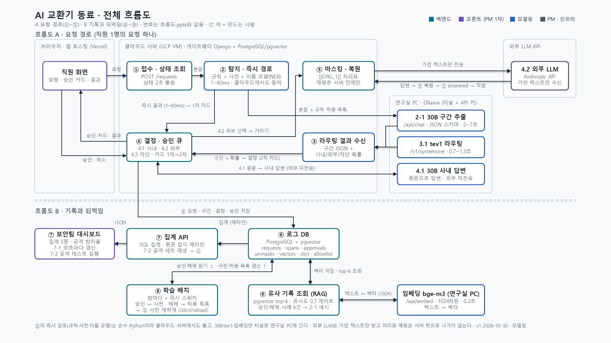

# WOOWANGTHON_TEAM_03_AI · AI 교환기 동료 — 모델링

충북대학교 2026 AI 우왕톤 팀 03 '초코 츄러스'의 AI 저장소. 외부 AI 사용이 막힌 회사에서 직원의 AI 요청을 검문하는 **AI 교환기 동료**의 모델 부분을 담는다. 담당 범위는 민감정보 처리(탐지·가림·복원), 모델 연동(연구실 PC Ollama 30B·tev1·임베딩, 외부 Anthropic API), AI 품질 검증이다. 화면·로그 DB·대시보드는 FE·BE 저장소에 있다.

요청문 하나가 들어오면 ① 글자 추출 → ② 즉시 탐지(규칙·사전·이름 인식) + 정밀 탐지(30B) → ③ 경로 판정(tev1) → ④ 결정 규칙(차단·사내·외부, 승인 카드) → ⑤ 가림(자리표 `[[ORG_1]]`) → 외부 LLM → 복원 순서로 처리한다. 번호는 아래 흐름도의 번호다.



## 폴더 구조

```
WOOWANGTHON_TEAM_03_AI/
├─ README.md
├─ requirements.txt                 실행 환경 고정 버전 (Python 3.12, Windows)
├─ requirements-dev.txt             단위 테스트·Actions 용 최소 의존성 (Ollama·torch 불필요)
├─ AGENTS.md                        팀 개발 에이전트 지침 요약 (PM 등록)
├─ assets/flowchart.png             위 전체 흐름도 그림
├─ .github/pull_request_template.md
├─ .github/workflows/tests.yml      push·PR 마다 pytest 실행
├─ tests/                           순수 함수 단위 테스트 (가림·복원, 결정 규칙, 정규식 규칙, 분할·병합·전파, 유출 검사, 서비스 입력 검증)
├─ src/                             모델 코드. 모듈이 서로를 최상위 이름으로 import 하므로 src 를 경로에 두고 실행한다
│  ├─ common.py                     경로, Ollama 호출(반드시 127.0.0.1), Span 자료형, 라벨 7종
│  ├─ extract.py                    PDF → 글자 (PyMuPDF). 글자를 고치지 않고 쪽 사이 빈 줄 하나. 흐름도 ①
│  ├─ detect_rules.py               정규식 26개(연락처·번호·사업명·금액·사람) + 사전(회사명·사업명) 즉시 탐지. 흐름도 ②
│  ├─ ner_detect.py                 공개 한국어 NER(atonlee/koelectra-ko-pii-ner, CPU)로 사람 이름만. 흐름도 ②
│  ├─ detect_llm.py                 Ollama 30B(qwen3:30b-a3b-instruct) JSON 스키마 구간 추출, 원문 포함 검사. 흐름도 2-1
│  ├─ detect.py                     즉시 경로와 30B 결과 병합·전파·다듬기, 지시 삽입 문장 지우기, 구분자 감싸기, 긴 글 분할. detect(text)
│  ├─ route.py                      tev1(/v1/systemone)에 기준 문구를 주고 사내·외부·차단 확률. 글이 길면 앞 6,000자만 보낸다. 흐름도 3.1 → ③
│  ├─ decide.py                     결정 규칙: 개인정보 묶음·통째 유출 차단, 내부 전용 사내 강제, 애매 판정, 승인 카드 필요 여부. 흐름도 ④
│  ├─ mask.py                       자리표 가림, 등급 정책(1 항상·2 이름 토글·3 비가림), 복원, 외부 안내문. 흐름도 ⑤
│  ├─ answer_external.py            Anthropic API(claude-sonnet-5-5) 호출: 전송 직전 유출 검사, 답변 자리표 복원, 거부·비용 추정. 흐름도 4.2
│  ├─ server.py                     FastAPI 모델 서비스(8010): /detect/instant /analyze /mask /restore /answer_local /answer_external /embed /dict/reload. 흐름도의 연구실 PC 상자 전체
│  ├─ eval.py                       평가 세트 재현율·오탐·민감 판정 정확도·지연 표
│  ├─ data/
│  │  ├─ samples.jsonl              기본 평가 세트 10건 (text, 정답 spans, 정답 route)
│  │  ├─ candidates/                밤 배치가 만든 후보·공격·영어·사내 세트. 정답 검토 전 원본(*_before_review_*, *_raw)은 archive/
│  │  ├─ demo/demo_docs_v1.jsonl    시연 문서 6건 D1~D6 (경로별 기대 결정, 등급별 정답 구간)
│  │  ├─ accept/                    실제 형태 수락 검사 TEST-01: 입력 PDF(츄러스공업, 가상 데이터), 정답표 TEST-01.json, 추출 글자 TEST-01.txt
│  │  └─ dict/                      companies.txt, projects.txt 사전. 한 줄에 하나, 세로줄(|)로 별칭
│  ├─ results/                      평가·점검 결과 md/json. eval_*, decide_check_*, route_check_*, demo_run_*, night*/report.md,
│  │                                gold_review_*, accept_*, server_check_*, external_check_*. 종류별 최신 실행분과
│  │                                문서·코드가 인용한 실행분만 두고 그 전 실행분은 archive/
│  └─ tools/
│     ├─ server_check.py            서비스 점검 17항목: 인증, 즉시 탐지 일치, 결정, 복원, 동시 호출, TEST-01, 사내 답변, 임베딩, 사전 재적재 (--external 이면 외부 호출까지 18항목)
│     ├─ external_check.py          외부 경로 점검: smoke 1회 + D3·D4·D6·TEST-01 을 가림 → Anthropic → 복원, 자리표 유지·유출·비용
│     ├─ accept_run.py              수락 검사: PDF + 정답표 → 탐지 → 경로 → 결정 → 가림. 사전 없음/등록 × 이름 토글 끔/켬
│     ├─ demo_run.py                시연 6건을 파이프라인에 넣어 기대 경로와 등급별 적중 비교, 팀 문서 초안 생성
│     ├─ decide_check.py            결정 규칙 회귀: 세트별 정답 경로·차단 비교
│     ├─ route_check.py             tev1 기준 문구 변형(v1~v5) 비교
│     ├─ gold_review.py             정답과 탐지기가 다른 곳만 모은 검토 목록
│     ├─ apply_gold_fixes.py        정답 검토 판정을 세트에 반영하고 변경 로그 작성
│     ├─ clean_candidates.py        후보 세트 기계 정리(중복·형식)
│     ├─ ner_probe.py               NER 모델 로딩·라벨·속도 확인
│     ├─ night_run.py ~ night_run4.py  밤 배치 실험: 라우팅 반복, 지연, few-shot 효과, 동시 호출, 긴 글, 프롬프트 3종, NER, RAG 게이트, M 모드. 일회성 실험 기록이다 (M 모드는 기각 뒤 코드에서 뺐으므로 night_run4 는 재현되지 않는다)
│     └─ md2pdf.py                  md → PDF (Word COM). 문서의 공유용 PDF 를 만들 때 쓴다
├─ ops/                             연구실 PC 상시 가동: 작업 스케줄러 등록(설치·제거), 감시, 상태 보기, 재시작 스크립트. 설명은 ops/README.md
└─ docs/
   └─ 모델 서비스 API v1 (2026-11-03).md       백엔드용 HTTP 명세: 경로별 입출력, 실패 동작, 시간, ⑥ 로그 DB 저장 대응
```

## 실행

연구실 PC(Windows, RTX 5060 Ti 8GB)에서 Ollama가 떠 있어야 한다. 모델은 `qwen3:30b-a3b-instruct-2507-q4_K_M`, `tev1-cpu`, `bge-m3-cpu`. Ollama 환경변수 `OLLAMA_MAX_LOADED_MODELS=3`, `OLLAMA_KEEP_ALIVE=-1`(없으면 30B가 매번 14~17초 재로드). 호출 주소는 `127.0.0.1`(localhost 는 IPv6 대기로 호출마다 2초).

```powershell
# 1) 환경 (Python 3.12). torch 는 CPU 판을 먼저 설치한다
python -m venv .venv
.venv\Scripts\python.exe -m pip install torch==2.15.0 --index-url https://download.pytorch.org/whl/cpu
.venv\Scripts\python.exe -m pip install -r requirements.txt

# 2) 모델 서비스. 키는 환경변수로만 준다 (코드·저장소에 넣지 않는다)
$env:MODEL_API_KEYS = "<백엔드가 쓸 X-API-Key>"     # 비우면 임시 키를 만들어 stderr 에 찍는다
$env:ANTHROPIC_API_KEY = "<외부 LLM 키>"             # /answer_external 용. 없으면 그 경로만 503
.venv\Scripts\python.exe src\server.py --port 8010   # 터널로 열 때는 --host 0.0.0.0

# 3) 점검
.venv\Scripts\python.exe src\tools\server_check.py                # 서비스 17항목, --external 이면 18항목 (서버를 직접 띄움)
.venv\Scripts\python.exe src\tools\external_check.py --smoke      # Anthropic 호출 1회
.venv\Scripts\python.exe src\tools\accept_run.py src\data\accept\TEST-01.json   # 수락 검사
.venv\Scripts\python.exe src\tools\demo_run.py --no-doc           # 시연 6건
.venv\Scripts\python.exe src\eval.py --no-llm                     # 규칙만 평가 (Ollama 없이)
```

백엔드가 부르는 경로와 응답 형식은 `docs/모델 서비스 API v1 (2026-11-03).md` 에 있다. 요청 하나의 순서는 접수 때 `/detect/instant`(수십 ms, 1차 카드) → 배경에서 `/analyze`(1~8초, 결정·가림 미리보기) → 승인 뒤 `/answer_external` 또는 `/answer_local` 이다.

## 상시 가동 (연구실 PC 운영)

연동·심사 기간에는 위 2) 를 손으로 띄우지 않고 `ops/` 로 작업 스케줄러에 등록해 둔다. 부팅 때 로그인 없이 Ollama 와 모델 서비스가 뜨고, 5분마다 감시가 상태를 기록하고 죽으면 다시 띄운다. 키·경로는 저장소 밖 `%LOCALAPPDATA%\woowang\service.env` 에 둔다.

```powershell
powershell -ExecutionPolicy Bypass -File ops\install_always_on.ps1   # 관리자, 한 번
powershell -ExecutionPolicy Bypass -File ops\status.ps1              # 상태·heartbeat 요약
powershell -ExecutionPolicy Bypass -File ops\restart.ps1             # 코드 갱신 뒤 (관리자)
```

자세한 구성·로그 위치·되돌리기는 `ops/README.md`.

## 코드와 전체 흐름도 대응

| 흐름도 | 코드 | 실행 위치 |
|---|---|---|
| ① 접수 · 글자 추출 | `extract.py` (백엔드가 PyMuPDF 로 직접 뽑아도 같은 규칙) | 클라우드 |
| ② 탐지 · 즉시 경로 | `detect_rules.py`, `ner_detect.py` | 클라우드에서도 동작(CPU) |
| 2-1 30B 구간 추출 | `detect_llm.py`, 병합은 `detect.py` | 연구실 PC Ollama |
| 3.1 tev1 라우팅 → ③ | `route.py` | 연구실 PC Ollama |
| ④ 결정 | `decide.py` (승인 큐·승인 API 는 백엔드) | 서버 |
| ⑤ 마스킹 · 복원 | `mask.py` | 서버 |
| 4.1 30B 사내 답변 | `server.py` `/answer_local` | 연구실 PC Ollama |
| 4.2 외부 LLM | `answer_external.py`, `server.py` `/answer_external` | 연구실 PC → Anthropic |
| 연구실 PC 상자(터널 + API 키) | `server.py` | 연구실 PC |
| ⑧ 사전 재적재, ⑨ 임베딩 | `server.py` `/dict/reload`, `/embed` (pgvector 검색·배치 로직은 백엔드) | 연구실 PC |

⑥ 로그 DB, ⑦ 집계·대시보드, ① 접수 API·상태 폴링, ④ 승인 큐는 BE·FE 저장소 범위다.

## 테스트

```powershell
.venv\Scripts\python.exe -m pip install -r requirements-dev.txt
.venv\Scripts\python.exe -m pytest -q
```

`tests/` 는 Ollama·GPU·외부 API 없이 순수 함수만 확인한다. 가림 뒤 복원이 원문과 같은지, 자리표 변형(`[[ ORG_1 ]]`, `[ORG_1]`, `[[org-1]]`) 복원, 결정 규칙 여덟 개, 정규식 규칙별 적중과 공개 규격 제외, 긴 글 분할·병합·전파·다듬기, 전송 직전 유출 검사, 서비스 입력 검증과 키 검사. GitHub Actions(`.github/workflows/tests.yml`)가 push 와 PR 마다 같은 테스트를 돈다. 모델 품질(재현율·오탐·지연)은 테스트가 아니라 아래 점검 스크립트와 결과 파일로 본다.

## 검증 결과 (연구실 PC 실측)

| 점검 | 실행일 | 결과 | 파일 |
|---|---|---|---|
| 서비스 점검 17항목 | 11-05 | 전부 통과. 즉시 탐지 16~27ms, /analyze 1.0\~7.4초, 동시 2건 직렬 9.6초. 외부 호출을 넣은 18항목(`--external`)은 11-03 에 전부 통과 | `src/results/server_check_20261105_0124.md`, `server_check_20261103_1234.md` |
| 외부 경로 D3·D4·D6·TEST-01 | 11-03 | 전송 본문에 원문 값 0건, 미복원 자리표 0. 번역(D3·D6)은 자리표 전부 유지, 요약(TEST-01)은 19종 중 14종이 답변에 나왔고 전부 복원. API 2.8~10초, 총 약 $0.044 | `src/results/external_check_20261103_1230.md`, `external_check_20261103_1234.md` |
| 수락 검사 TEST-01 (2쪽 2,546자) | 11-11 | 1등급 19값 전부 가림, 이름 토글 끔·켬 정상, 유지 항목 보존 | `src/results/accept_TEST-01_20261111_1726.md` |
| 시연 6건 | 11-11 | 결정 6/6 기대 경로 일치. 가림 뒤 복원 원문 일치 6/6 은 11-05 서비스 점검에서 확인 | `src/results/demo_run_20261111_1727.md` |
| 세트별 혼합 재현율 (정답 검토 뒤) | 10-30 | 후보 100%, 공격 100%, 공격 2차 99%, 사내 100%, 영어 96%, 시연 100%, 오탐 전 세트 0, 잘못 차단 0 | `src/results/gold_review_20261030_0317/disagreements.md`, `decide_check_20261030_0327.md` |

11-05(TK-47)와 11-11(TK-77·TK-80)에 규칙과 전파를 고친 뒤 다시 돌린 것은 수락 검사와 시연 6건이다. 서비스 점검은 11-11 변경 뒤에 돌리지 않았고, 외부 경로 점검과 세트별 재현율은 11-05 변경 전 코드로 낸 수치다.

번역·요약의 품질은 숫자로 판정하지 않았고 `external_check` 결과 파일의 복원 답변을 사람이 읽어 확인한다. 평가 세트와 시연 문서는 전부 30B로 만든 합성 문서이며 회사·사업명은 가상이다.

## 데이터와 비밀값

- 저장소의 모든 테스트 자료(평가 세트, 시연 문서, 츄러스공업 PDF)는 가상 데이터다. 실제 회사 문서는 없다.
- API 키(`MODEL_API_KEYS`, `ANTHROPIC_API_KEY`)는 환경변수로만 주고 커밋하지 않는다. `.gitignore` 가 `.env`, `*.key` 를 막는다.
- 서버 로그에는 요청 id·글자 수·구간 수·결정·시간만 남고 원문·대응표·문서명은 남지 않는다.
- 외부 LLM 에는 가림 본문만 나가고, 자리표 대응표는 연구실 PC 서비스 응답과 백엔드 DB 에만 있다.

## 관련 Notion

- TK-37 AI 저장소 초기 등록: https://app.notion.com/p/ad50622a602b4a03a006a166764e4f38
- TK-31 연구실 PC 모델 서비스(FastAPI) 포장: https://app.notion.com/p/f1ef2c7e78c84a1cad528beef7ea71ba
- TK-32 사내 답변 /answer_local 구현: https://app.notion.com/p/4f8f3a8f87c84d5a82e4061e2339c856
- TK-48 연구실 PC 상시 가동 설정: https://app.notion.com/p/40e3c6fc5e82812f89e3dc5b0d7bb8f5
- DC-9 모델 서비스 배치(연구실 PC FastAPI + Tailscale): https://app.notion.com/p/419f17e213c0462c9dee01c471f32f87
- AI Agent 개발 지침: https://app.notion.com/p/4033c6fc5e8280a38dd6fd42c3f3c31d
